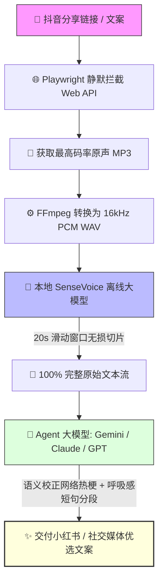

<div align="center">

# 🎙️ ayubal-douyin-transcribe

**抖音短视频纯本地离线高精度语音转写 Skill | 跨 Agent 智能体全生态兼容**

[](https://www.python.org/)
[](https://github.com/k2-fsa/sherpa-onnx)
[](https://github.com/FunAudioLLM/SenseVoice)
[](./LICENSE)
[](#)

<p align="center">
  <b>零付费 API</b> • <b>零第三方 Token 消耗</b> • <b>100% 本地离线运行</b> • <b>无 GUI 窗口极速静默转写</b><br>
  专为 <b>Antigravity、Claude Code、Codex、Cursor、Qwen Code</b> 等前沿 AI Agent 打造的一键逐字稿提炼工作流。
</p>

</div>

---

## 💡 为什么需要这个项目？

目前在 AI 智能体生态中提取短视频文案通常面临以下痛点：
1. **费用昂贵**：传统方案大多依赖 TikHub、轻抖等商业闭源 API，每转写一条视频都要扣费；
2. **界面笨重**：许多开源工具绑定复杂的 Electron/Tauri 桌面客户端，无法作为纯命令行能力无缝嵌入 AI Agent 工作流；
3. **丢字漏句**：长视频直接喂给普通 ASR 模型极易因为超过单次上下文限制而丢弃大量语句；
4. **排版反人类**：未经处理的转写要么是无标点的几万字大泥潭，要么被过度总结成机械式 PPT 大纲，丧失了视频口播的原汁原味。

`ayubal-douyin-transcribe` 彻底解决了这些问题：
通过 **Playwright 无头静默拦截** + **FFmpeg 单声道转换** + **SenseVoice 20s 滑动窗口切片解码** + **智能体语义纠偏与呼吸感排版**，一键跑通闭环！

---

## 🏗️ 架构流向图 (Architecture)



---

## ✨ 核心亮点

- ⚡ **零外部依赖 & 零成本**：全链路本地运行，无需任何第三方付费平台账号，隐私安全 100%。
- 🎯 **20 秒切片算法内置**：专为口播短视频优化的连续滑动窗口机制，彻底杜绝长音频吞字断句问题。
- 📱 **社交媒体呼吸感排版**：严格规范智能体交付，输出每 1～2 句话自然空行的小红书/短视频爆款文案排版。
- 🔍 **黑话与网络热梗智能纠偏**：结合大语言模型的上下文常识，自动校正 ASR 对生僻热词（如 `vibe coding`、`薄肌理论`、`HC` 等）的同音偏差。
- 🔌 **全 Agent 通用**：完全遵循标准开放 Skill 规范，可在 Antigravity、Claude Code、Codex 等各主流智能体间自由迁移。

---

## 🚀 快速上手 (Quick Start)

### 1. 环境准备

确保本机已安装 Python 3.10+ 和 FFmpeg：

```bash
# 安装 Python 依赖
pip install sherpa-onnx playwright
playwright install msedge   # 或 playwright install chromium
```

### 2. SenseVoice 模型准备

本工具支持自动发现本地模型文件（`model.onnx` 与 `tokens.txt`）。默认会按以下顺序扫描：
1. 环境变量 `SENSE_VOICE_MODEL_DIR`
2. `AppData/DouyinCreatorToolkit/models/asr/sense-voice`
3. `~/.cache/sherpa-onnx/sense-voice`
4. 本项目根目录下 `models/sense-voice`

> 💡 **模型下载**：如本地尚未持有权重，可从 [sherpa-onnx 官方发布页](https://github.com/k2-fsa/sherpa-onnx/releases) 下载 SenseVoice-Small ONNX 格式模型解压至上述任意目录。

### 3. 命令行运行

```bash
# 方式 A：直接传入抖音分享链接或口令
python scripts/douyin_transcribe.py "5.87 复制打开抖音，看看【xxx的作品】... https://v.douyin.com/xxxx/ "

# 方式 B：管道输入
echo "https://v.douyin.com/xxxx/" | python scripts/douyin_transcribe.py --stdin

# 方式 C：输出结构化 JSON（供 Agent 二次解析）
python scripts/douyin_transcribe.py "https://v.douyin.com/xxxx/" --json
```

---

## 🤖 跨 Agent 智能体配置与使用

将本项目复制或软链至各 Agent 的 Skills 目录下即可全局生效：

### 1. Google Antigravity
放入 `~/.gemini/config/skills/ayubal-douyin-transcribe`。
直接在对话中发送链接并附带指令：
> “转写这条视频，排版好一点”

### 2. Claude Code
直接引入本技能，Claude 将会在检测到抖音短链时自动通过 Bash 运行 `scripts/douyin_transcribe.py --json`，并自动执行语义修复后交付。

### 3. OpenAI Codex / Cursor
作为终端工具集成到项目的 `.agent/skills/` 目录中即可随时唤起。

---

## 📜 交付排版样式示例

经过 Agent 语义调优后的标准输出风格：

```markdown
什么薄肌理论、大学理论都不如我的摆摊理论。

但凡你还在上大学，毕业想找份双休不加班还能月薪过万的好工作，就一定要遵循我的摆摊理论。

不管是摆摊卖烧烤、卖炒饭，还是手抓饼、烤冷面、淀粉肠、酱香饼都可以。

要我说你就去摆摊，别光搞什么大创赛，或者整什么 vibe coding、拿 AI 做个软件做个网页，那些在摆摊面前都不够看的。

你想想你去参加那大创赛，那不就是 PPT 大赛嘛，能有几个有真实的产品、真实的实操、有真实的盈利啊？
```

---

## 📄 开源许可证

本项目基于 [MIT License](./LICENSE) 开源。欢迎 Star 🌟 与提交 PR！
