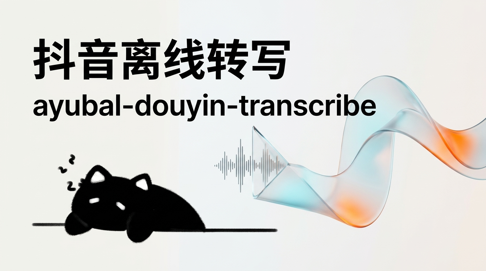

<div align="center">



# ayubal-douyin-transcribe

**抖音短视频本地离线语音转写工具与 Agent Skill**

[](https://www.python.org/)
[](https://github.com/k2-fsa/sherpa-onnx)
[](https://github.com/FunAudioLLM/SenseVoice)
[](./LICENSE)
[](#)

</div>

---

抖音短视频本地离线语音转写工具与 Agent Skill。

输入抖音分享链接或文本，工具通过 Playwright 抓取原声音频直链，利用本地 SenseVoice 模型进行 20 秒切片语音识别，输出按自然口播停顿分段的文字稿。

无需购买第三方数据接口，无需启动桌面端程序，可在终端直接执行，也可作为 Skill 配置给 Antigravity、Claude Code、Codex 等 Agent 调用。

---

## 怎么和 AI 交流使用？

安装好 Skill 后，不需要手动敲复杂的终端命令。直接把抖音分享口令或链接发给你的 AI（Antigravity、Claude Code、Codex、Cursor 等），搭配常用自然语言指令即可触发：

### 1. 基础转写与排版

直接把复制的抖音分享文案连同链接丢给 AI：

> 「5.87 复制打开抖音，看看【xxx的作品】... https://v.douyin.com/xxxx/ 这条视频的文字稿给到我，排版好一点」

> 「帮我把这个视频转成逐字稿：https://v.douyin.com/xxxx/」

AI 会自动调度后台脚本下载音频、完成 20 秒切片识别，并自动按自然语意换气空行排版交付。

### 2. 常见场景指令

根据你的后续创作需求，可以直接吩咐 AI：

- **保持原汁原味口播**：
  > 「转写这段视频，只要原话，不要多余的大纲总结和加粗小标题」
- **二创与文案改写**：
  > 「提取这个视频的文字稿，并按这个核心逻辑帮我改写成一篇小红书图文文案」
- **干货金句提炼**：
  > 「把这个视频转成文字，并帮我挑出作者说的 3 句最有启发的核心观点」
- **爆款开头拆解**：
  > 「提取这段口播，分析作者前 5 秒是用什么钩子吸引观众看下去的」

---

## 安装到你的 AI

### 方式一：一键安装（推荐）

通过通用 Skill 工具一键安装到你的 Agent：

```bash
npx skills add AayuBal/ayubal-douyin-transcribe
```

### 方式二：手动克隆或放置

将本项目克隆到对应 Agent 的 Skills 目录下即可生效：

```bash
# 克隆仓库
git clone https://github.com/AayuBal/ayubal-douyin-transcribe.git
```

- **Google Antigravity**：放入 `~/.gemini/config/skills/ayubal-douyin-transcribe`
- **Claude Code**：放入 Claude 的 skills 配置目录
- **OpenAI Codex / Cursor**：放入项目根目录下的 `.agent/skills/ayubal-douyin-transcribe`

---

## 环境准备

本 Skill 在你的电脑本地运行，需确保系统已安装基础 Python 依赖与 FFmpeg：

```bash
# 安装 Python 库
pip install sherpa-onnx playwright

# 安装 Playwright 浏览器内核
playwright install msedge   # 或 playwright install chromium
```

### SenseVoice 模型文件

工具会自动索引本地模型（`model.onnx` 与 `tokens.txt`），优先查找：
1. 环境变量 `SENSE_VOICE_MODEL_DIR`
2. `AppData/DouyinCreatorToolkit/models/asr/sense-voice`（若电脑中安装过相关工具箱）
3. `~/.cache/sherpa-onnx/sense-voice`
4. 本项目根目录下的 `models/sense-voice`

> 首次使用若本地没有模型，可从 [sherpa-onnx 官方发布页](https://github.com/k2-fsa/sherpa-onnx/releases) 下载 SenseVoice-Small ONNX 模型解压至上述任意目录。

---

## 工作流程


---

## 功能特点

- **完全本地运行**：语音识别由本地的 SenseVoice ONNX 模型完成，不依赖外部付费转写 API，无 Token 费用。
- **长音频 20 秒切片**：针对长视频按 20 秒滑动窗口分块推理，避免长音频单次解码导致的丢句漏字。
- **无 GUI 窗口**：全流程由 Python 脚本在后台无头运行，适合直接嵌入各类命令行 Agent 的自动化链路。
- **短句分段排版**：输出格式遵循移动端阅读习惯，每 1～2 句话独立成段，段落间空行，不增加概括性大纲与列表编号。
- **术语纠错指引**：在 Agent 规范中内置了针对网络热词与英文术语（如 `vibe coding`、`薄肌理论` 等）的语义校正要求。

---

## 输出排版样式

经过 Agent 纠偏与换气排版后的标准交付效果：

```text
什么薄肌理论、大学理论都不如我的摆摊理论。

但凡你还在上大学，毕业想找份双休不加班还能月薪过万的好工作，就一定要遵循我的摆摊理论。

不管是摆摊卖烧烤、卖炒饭，还是手抓饼、烤冷面、淀粉肠、酱香饼都可以。

要我说你就去摆摊，别光搞什么大创赛，或者整什么 vibe coding、拿 AI 做个软件做个网页，那些在摆摊面前都不够看的。

你想想你去参加那大创赛，那不就是 PPT 大赛嘛，能有几个有真实的产品、真实的实操、有真实的盈利啊？
```

---

<details>
<summary><b>开发者说明：底层命令行执行方式（点击展开）</b></summary>

如果你需要脱离 AI Agent 在终端单独批量测试，也可以直接运行底层脚本：

```bash
# 1. 直接传入短链接或分享文本
python scripts/douyin_transcribe.py "https://v.douyin.com/xxxx/"

# 2. 从标准输入读取
echo "https://v.douyin.com/xxxx/" | python scripts/douyin_transcribe.py --stdin

# 3. 输出结构化 JSON
python scripts/douyin_transcribe.py "https://v.douyin.com/xxxx/" --json
```

</details>

---

## 许可证

本项目采用 [MIT License](./LICENSE) 授权。
